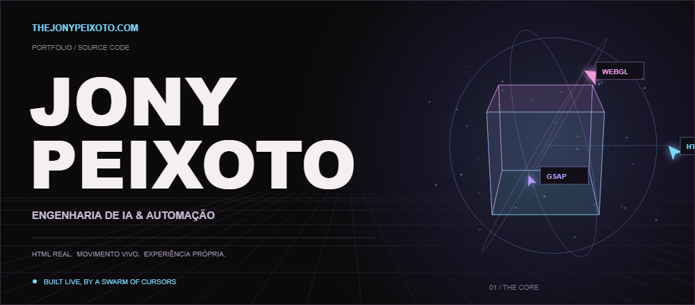
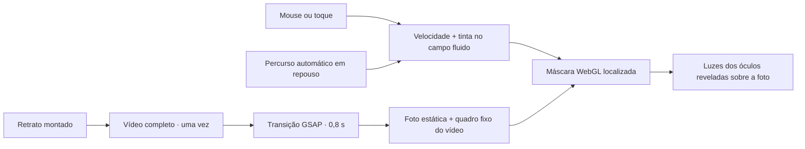
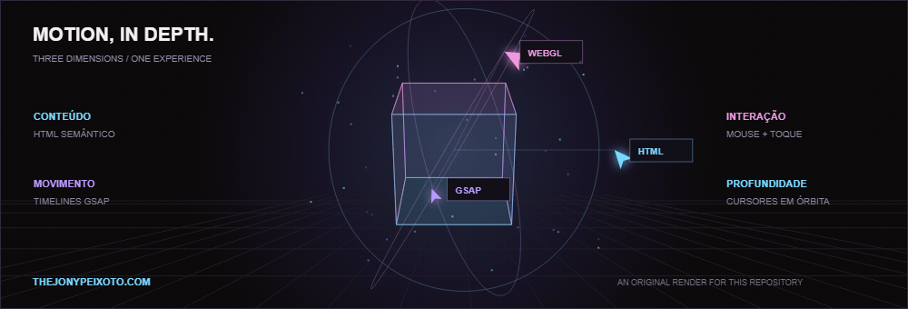

<p align="center">
  <a href="https://www.thejonypeixoto.com/">
    
  </a>
</p>

<h1 align="center">THEJONYPEIXOTO.COM</h1>
<p align="center"><strong>O portfólio que se constrói na sua frente.</strong><br />Jony Peixoto · Cirurgião Digital · Engenharia de IA & Automação</p>

<p align="center">
  <a href="https://www.thejonypeixoto.com/">Visitar o site</a> ·
  <a href="https://tally.so/r/Z9OlBy">Diagnóstico do seu projeto</a> ·
  <a href="docs/ARQUITETURA.md">Arquitetura</a> ·
  <a href="docs/MOTION.md">Por dentro das animações</a>
</p>

<p align="center">
  <a href="https://github.com/jonypeixoto/thejonypeixoto.com/actions/workflows/build.yml"></a>
  
  
  
  
</p>

## Uma experiência, além de uma página

O visitante acompanha um enxame de cursores montando o portfólio: seleções com medidas, rascunhos, letras digitadas, elementos arrastados até encaixar e cards que nascem de cópias. O conteúdo já existe como HTML; o movimento revela a interface progressivamente.

O projeto reúne a identidade de Jony Peixoto, projetos de IA e automação, trajetória profissional e gamer, canal no YouTube, uma vitrine de IAs, marcas e newsletter. O contato leva ao diagnóstico no Tally, ao WhatsApp e a um formulário próprio da página.

[](https://www.thejonypeixoto.com/)

> As cenas 3D deste README são animações renderizadas em GIF. Para interagir com o rosto, os cursores e os componentes, abra o site. O GIF de demonstração é uma captura da versão local; o domínio pode estar em uma versão diferente.

## O que acontece na tela

| Experiência | Implementação |
|---|---|
| **Montagem ao vivo** | Fila de tarefas GSAP, agentes independentes e atributos declarativos no HTML. |
| **Retrato em vídeo** | O vídeo completo toca uma vez depois da montagem do retrato. |
| **Óculos fluidos** | Ao final, a foto fica estática e um campo fluido revela as luzes dos óculos com mouse, dedo ou movimento automático. |
| **Cursores em profundidade** | Setas atravessam o espaço com perspectiva, desfoque e movimento em curva. |
| **Tour guiado** | Percorre as seções e acompanha a montagem; inclui 1×, 2×, 4× e replay. |
| **Projetos exploráveis** | Busca, filtros por categoria, trilho mobile e comparador de rascunho/tela final. |
| **Trajetória gamer** | Carrossel em leque, com perspectiva, foco e entrada elástica; montado como uma ilha React. |
| **Conteúdo em cinco idiomas** | Português, inglês, espanhol, russo e chinês, com seleção por URL e preferência local. |
| **Contato conectado** | Diagnóstico no Tally, mensagens localizadas no WhatsApp e envio via Web3Forms. |
| **Movimento acessível** | Preferência por movimento reduzido, pausa fora da tela e rolagem nativa no celular. |

## Rodar localmente

Use **Node.js 22.12 ou superior** e npm. A captura de referência desta documentação foi feita com Node.js 26.13.0 no Windows.

```bash
git clone https://github.com/jonypeixoto/thejonypeixoto.com.git
cd thejonypeixoto.com
npm ci
npm run dev
```

Abra [localhost:5300](http://localhost:5300/). Para acessar pelo celular na mesma rede:

```bash
npm run dev -- --host 0.0.0.0
```

| Comando | Resultado |
|---|---|
| `npm run dev` | Desenvolvimento com Vite, porta 5300 e atualização dos arquivos. |
| `npm run build` | Gera os arquivos de produção em `dist/`. |
| `npm run preview` | Serve o build localmente na porta 5300; encerre o dev antes. |

### Modos de visualização

| URL local | Uso |
|---|---|
| `http://localhost:5300/` | Experiência completa de montagem. |
| `http://localhost:5300/?pronto` | Conteúdo montado, sem a sequência de construção. Os efeitos do retrato continuam ativos. |
| `http://localhost:5300/?lang=pt` | Abre em português. Também aceita `en`, `es`, `ru` e `zh`. |
| `http://localhost:5300/?reel=0.82` | Ajusta os brancos para gravação e esconde a barra de rolagem. |
| `http://localhost:5300/?pronto&lang=pt` | Revisão visual em português, sem esperar a montagem. |

`prefers-reduced-motion: reduce` abre a página montada, desativa os agentes e mantém o retrato estático.

## Stack e decisões

**HTML modular + CSS + JavaScript ES Modules** formam a página. O Vite expande os arquivos de seção no HTML de desenvolvimento e no build; o resultado é um site estático. React e React DOM ficam concentrados na ilha do carrossel gamer, carregada sob demanda.

| Camada | Ferramentas |
|---|---|
| Build | Vite 8.3.5 e plugin local `secoes` |
| Motion | GSAP 3.15.0 |
| Retrato | WebM com alfa; MP4 com cor/máscara lado a lado como alternativa |
| Composição dos óculos | WebGL + campo fluido local em JavaScript |
| Ilha de interface | React / React DOM 19.3.1 |
| Tipografia | Anton, Manrope, Caveat e Space Mono via Fontsource |
| Design | Tokens CSS, escalas `--u` / `--su`, azul, violeta e rosa sobre fundo escuro |
| Serviços externos | Tally, Web3Forms, WhatsApp, YouTube e Substack |

## Mapa do código

```text
.
├── index.html                # Metadados, modos de abertura e marcas de seção
├── vite.config.js            # Expansão recursiva do HTML modular
├── src/
│   ├── main.js               # Fontes, estilos e inicialização dos módulos
│   ├── estilo.js             # Liberação da página depois da chegada do CSS
│   ├── sections/             # HTML e CSS de cada seção
│   ├── motion/               # Enxame, rosto, carrosséis e interações
│   ├── components/           # Ilha React do carrossel em leque
│   ├── locales/              # Dicionários dos cinco idiomas
│   └── styles/               # Tokens, base, componentes e CSS do enxame
├── public/
│   ├── img/                  # Retratos, projetos, marcas, notícias e bandeiras
│   ├── video/                # Vídeos próprios do retrato
│   ├── arquivos/             # PDF disponibilizado no site
│   └── favicon.svg
├── docs/                     # Arquitetura, motion, operação e decisões
│   ├── media/                # GIFs e capturas do README
│   └── tools/                # Fontes reproduzíveis das animações 3D
└── .github/workflows/        # Build automático em push e pull request
```

## A engenharia por trás dos óculos



O campo de **80 × 128 células** transporta e dissipa o rastro. O shader combina essa máscara com a região dos óculos e suas luzes ciano, azuis e violetas. O vídeo fica pausado durante essa etapa: a expressão do rosto não acompanha o rastro.

A referência de comportamento foi o hero de [Lando Norris](https://landonorris.com/), analisado com gravações de desktop e mobile e o fluxo da [Reanimate](https://github.com/NiazMorshed2007/reanimate). O resultado usa as mídias do projeto e uma simulação própria; **não é uma reprodução 1:1 comprovada** da simulação original.

## Documentação completa

| Documento | O que você encontra |
|---|---|
| [Arquitetura](docs/ARQUITETURA.md) | Inicialização, seções, responsabilidades dos módulos, CSS e React. |
| [Motion e interação](docs/MOTION.md) | Contrato `data-*`, montagem, Tour, vídeo, alfa, campo fluido e acessibilidade. |
| [Manutenção e publicação](docs/MANUTENCAO.md) | Como trocar conteúdo, integrar serviços, executar o build e publicar. |
| [Registro de implementação](docs/IMPLEMENTACAO.md) | Base original, personalizações presentes e evolução feita nesta sessão. |
| [Validação](docs/VALIDACAO.md) | Checagens executadas, evidências disponíveis e limitações conhecidas. |
| [Créditos e uso de assets](docs/CREDITOS.md) | Origem da base, referências, dependências, mídia e direitos de uso. |
| [Animações do README](docs/tools/README.md) | Como gerar novamente as cenas 3D e os GIFs. |

## Publicação

```bash
npm ci
npm run build
```

Publique o **conteúdo de `dist/`** em uma hospedagem estática. Não é necessário executar um servidor Node.js em produção. O site usa caminhos absolutos a partir de `/`, portanto a hospedagem deve servir a aplicação na raiz do domínio.

O workflow deste repositório valida o build; ele **não altera DNS nem publica automaticamente no domínio**. Consulte [Manutenção e publicação](docs/MANUTENCAO.md) antes de configurar a hospedagem.

## Qualidade e limites conhecidos

- Checagens locais em Chromium a 1456 × 840 e 390 × 844, incluindo toque emulado.
- Tour, replay, pausa fora da tela, movimento reduzido e overflow horizontal verificados durante a implementação do retrato.
- Build local aprovado; aviso existente de `"use client"` no carrossel JSX, sem impedir a geração.
- Safari e aparelhos físicos precisam de revisão específica. Não há resultado de Lighthouse ou cobertura automatizada de testes anunciado.
- A base Kairo ainda aparece em guias herdados e mídias demonstrativas de projetos. Essas referências estão identificadas nos [créditos](docs/CREDITOS.md); números e casos devem ser confirmados editorialmente pelo responsável pelo site.

<p align="center">
  
</p>

<p align="center"><strong>Do processo repetitivo à experiência que funciona.</strong><br />
<a href="https://tally.so/r/Z9OlBy">Conte sobre seu próximo projeto</a> ·
<a href="https://github.com/jonypeixoto">@jonypeixoto</a> ·
<a href="https://www.youtube.com/@thejonypeixoto">YouTube</a> ·
<a href="https://jonypeixoto.substack.com/">Newsletter</a></p>
