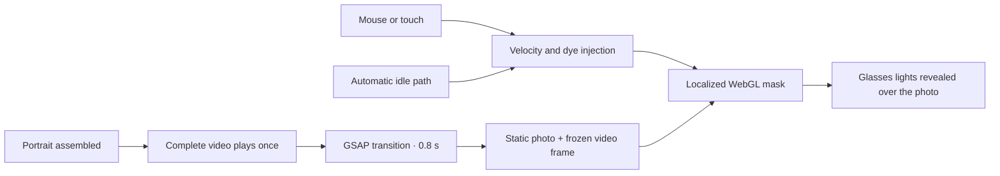
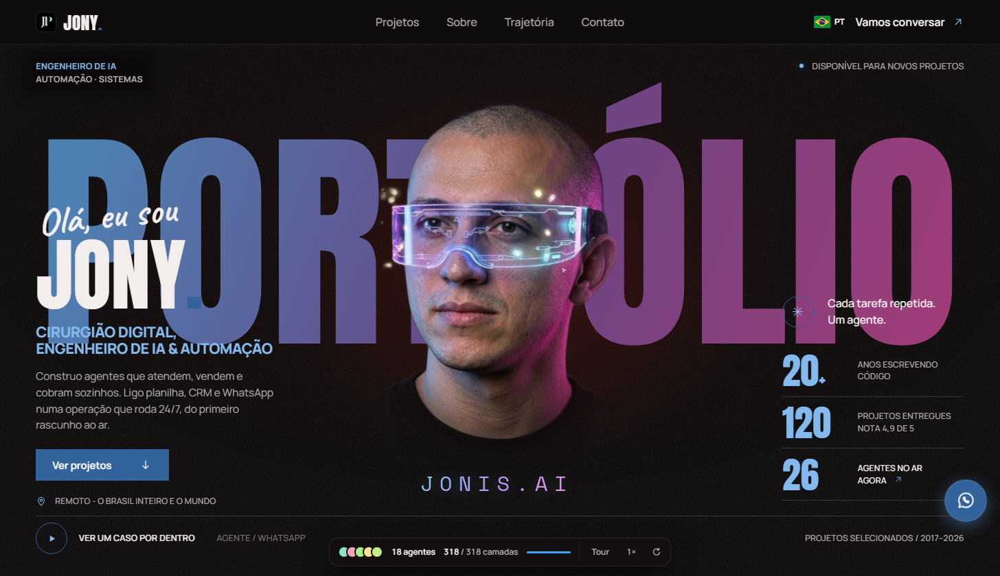

<p align="center">
  <a href="README.md"></a>
  <a href="README.pt-BR.md"></a>
  <a href="README.ru.md"></a>
  <a href="README.zh-CN.md"></a>
</p>
<p align="center"><strong>English</strong> · <a href="README.pt-BR.md">Português</a> · <a href="README.ru.md">Русский</a> · <a href="README.zh-CN.md">简体中文</a></p>

<p align="center">
  <a href="https://www.thejonypeixoto.com/">
    
  </a>
</p>

<h1 align="center">THEJONYPEIXOTO.COM</h1>
<p align="center"><strong>A portfolio that builds itself in front of you.</strong><br />Jony Peixoto · Digital Surgeon · AI & Automation Engineering</p>

<p align="center">
  <a href="https://www.thejonypeixoto.com/">Explore the website</a> ·
  <a href="https://tally.so/r/Z9OlBy">Start your project diagnosis</a> ·
  <a href="docs/ARQUITETURA.md">Architecture</a> ·
  <a href="docs/MOTION.md">Inside the animations</a>
</p>

<p align="center">
  <a href="https://github.com/jonypeixoto/thejonypeixoto.com/actions/workflows/build.yml"></a>
  
  
  
  
</p>

## An experience beyond a page

A swarm of cursors assembles the portfolio in view: measurement boxes, wireframes, typed letters, elements dragged into place, and cards created from copies. The content already exists as HTML; motion progressively reveals the interface.

The project brings together Jony Peixoto's identity, AI and automation projects, professional and gaming experience, YouTube channel, AI showcase, brands, and newsletter. Contact options lead to a Tally diagnosis, WhatsApp, and an on-page form.

[](https://www.thejonypeixoto.com/)

> The README's 3D scenes are rendered GIF animations. Open the website to interact with the portrait, cursors, and components. The demonstration was captured from the local build, which may differ from the version currently on the domain.

## What happens on screen

| Experience | Implementation |
|---|---|
| **Live assembly** | A GSAP task queue, independent agents, and declarative HTML attributes. |
| **Video portrait** | The complete portrait video plays once after its assembly finishes. |
| **Fluid glasses** | The portrait becomes static; a fluid field reveals the glasses with mouse, touch, or automatic idle motion. |
| **Cursors in depth** | Arrows travel through perspective space with blur and curved movement. |
| **Guided Tour** | Visits sections and follows assembly, with 1×, 2×, 4×, and replay controls. |
| **Explorable projects** | Search, category filters, mobile rails, and a wireframe/final-screen comparison. |
| **Gaming journey** | A perspective card fan with focus and an elastic entrance, implemented as a React island. |
| **Five website languages** | Portuguese, English, Spanish, Russian, and Chinese, with URL and saved-preference selection. |
| **Connected contact** | Tally diagnosis, localized WhatsApp messages, and Web3Forms submission. |
| **Accessible motion** | Reduced-motion preferences, offscreen pausing, and native mobile scrolling. |

## Run locally

Use **Node.js 22.12 or later** and npm. The documented development environment used Node.js 26.13.0 on Windows.

```bash
git clone https://github.com/jonypeixoto/thejonypeixoto.com.git
cd thejonypeixoto.com
npm ci
npm run dev
```

Open [localhost:5300](http://localhost:5300/). To access the site from a phone on the same network:

```bash
npm run dev -- --host 0.0.0.0
```

| Command | Purpose |
|---|---|
| `npm run dev` | Vite development server on port 5300. |
| `npm run build` | Generate the production website in `dist/`. |
| `npm run preview` | Serve the production build on port 5300; stop the dev server first. |

### Viewing modes

| Local URL | Purpose |
|---|---|
| `http://localhost:5300/` | Complete live assembly experience. |
| `http://localhost:5300/?pronto` | Start with assembled content. Portrait effects remain active. |
| `http://localhost:5300/?lang=en` | Open in English. Also accepts `pt`, `es`, `ru`, and `zh`. |
| `http://localhost:5300/?reel=0.82` | Adjust whites for screen recordings and hide the scrollbar. |
| `http://localhost:5300/?pronto&lang=en` | Review the assembled layout in English. |

`prefers-reduced-motion: reduce` starts with assembled content, disables agents, and keeps the portrait static. The README language buttons open separate documentation files; website language selection is independent.

## Stack and decisions

**Modular HTML, CSS, and JavaScript ES Modules** form the main page. Vite expands section files during development and build, producing a static website. React and React DOM are limited to the gaming carousel island, loaded on demand.

| Layer | Tools |
|---|---|
| Build | Vite 8.3.5 and the local `secoes` plugin |
| Motion | GSAP 3.15.0 |
| Portrait | Alpha WebM; a side-by-side color/mask MP4 fallback |
| Glasses composition | WebGL and a local JavaScript fluid field |
| UI island | React / React DOM 19.3.1 |
| Typography | Anton, Manrope, Caveat, and Space Mono via Fontsource |
| Design | CSS tokens, `--u` / `--su` scales, blue, violet, and pink on dark surfaces |
| External services | Tally, Web3Forms, WhatsApp, YouTube, and Substack |

## Code map

```text
.
├── index.html                # Metadata, startup modes, section markers
├── vite.config.js            # Recursive modular HTML expansion
├── src/
│   ├── main.js               # Fonts, styles, module initialization
│   ├── estilo.js             # Reveal the page after CSS is ready
│   ├── sections/             # Each section's HTML and CSS
│   ├── motion/               # Swarm, portrait, carousels, interactions
│   ├── components/           # Gaming carousel React island
│   ├── locales/              # Five website translation dictionaries
│   └── styles/               # Tokens, base, shared pieces, swarm styles
├── public/
│   ├── img/                  # Portraits, projects, brands, news, flags
│   ├── video/                # Project portrait videos
│   ├── arquivos/             # Downloadable PDF
│   └── favicon.svg
├── docs/                     # Architecture, motion, operations, decisions
│   ├── media/                # README GIFs and screenshots
│   └── tools/                # Reproducible 3D animation source
└── .github/workflows/        # Build on pushes and pull requests
```

## Engineering the fluid glasses



An **80 × 128 cell field** transports and dissipates the trail. The shader combines it with the glasses region and cyan, blue, violet, and highlight selection. The video stays paused during this stage, so the face does not move with the trail.

The behavior was inspired by [Lando Norris's hero](https://landonorris.com/), studied through desktop/mobile recordings and the [Reanimate](https://github.com/NiazMorshed2007/reanimate) workflow. This adaptation uses the project's media and its own local simulation. **A frame-by-frame 1:1 match with the original has not been established.**

## Full documentation

The detailed engineering guides are currently written in **Portuguese**. The four README editions provide the project overview in their respective languages.

| Guide | Contents |
|---|---|
| [Architecture](docs/ARQUITETURA.md) | Startup order, sections, module responsibilities, CSS, and React. |
| [Motion and interaction](docs/MOTION.md) | The `data-*` contract, assembly, Tour, video, alpha, fluid field, and accessibility. |
| [Maintenance and deployment](docs/MANUTENCAO.md) | Editing content, configuring services, building, and publishing. |
| [Implementation record](docs/IMPLEMENTACAO.md) | Original foundation, existing customizations, and this session's changes. |
| [Validation](docs/VALIDACAO.md) | Performed checks, available evidence, and known limitations. |
| [Credits and asset usage](docs/CREDITOS.md) | Foundation, references, dependencies, media, and usage rights. |
| [README animations](docs/tools/README.md) | Regenerating the 3D scenes and GIFs. |

## Deployment

```bash
npm ci
npm run build
```

Publish the **contents of `dist/`** to static hosting. A Node.js production server is not required. Assets use absolute paths starting at `/`, so the application is expected at the domain root.

The repository workflow validates builds. It **does not change DNS or automatically deploy to the domain**. Review the [deployment guide](docs/MANUTENCAO.md) before connecting hosting.

## Quality and known limitations

- Local Chromium checks at 1456 × 840 and 390 × 844, including emulated touch.
- Tour, replay, offscreen pausing, reduced motion, and horizontal overflow checked during portrait implementation.
- Local production build passed; the existing `"use client"` warning in the JSX carousel does not prevent output.
- Safari and physical devices require separate review. No Lighthouse score or automated test coverage is claimed.
- Legacy Kairo guides and demonstrative project media remain, identified in [credits](docs/CREDITOS.md). Project cases, metrics, and copy require editorial confirmation by the site owner.

<details>
<summary>View desktop and mobile screenshots</summary>

<p align="center">
  
  
</p>

</details>

<p align="center"></p>
<p align="center"><strong>From repetitive processes to experiences that work.</strong><br />
<a href="https://tally.so/r/Z9OlBy">Tell me about your next project</a> ·
<a href="https://github.com/jonypeixoto">@jonypeixoto</a> ·
<a href="https://www.youtube.com/@thejonypeixoto">YouTube</a> ·
<a href="https://jonypeixoto.substack.com/">Newsletter</a></p>
