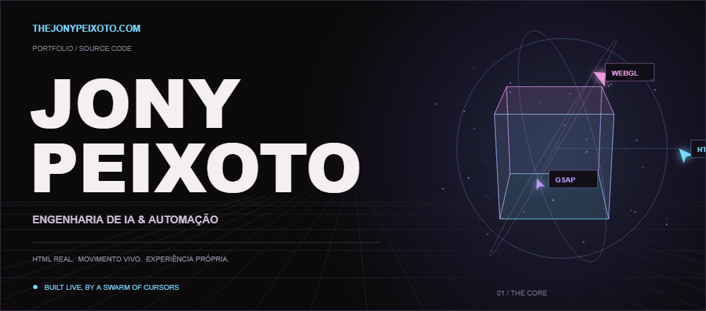
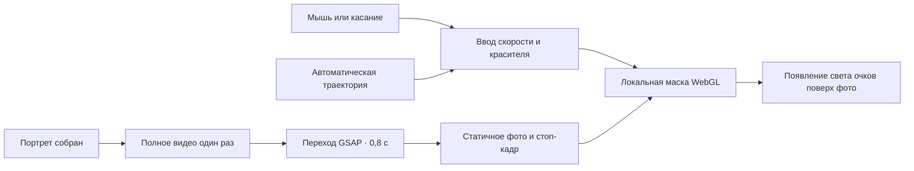
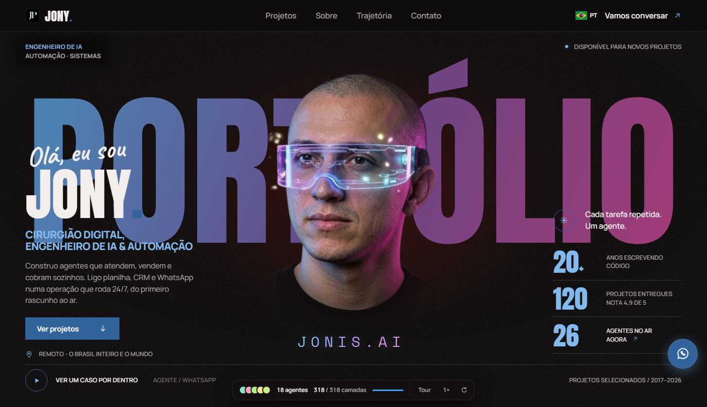
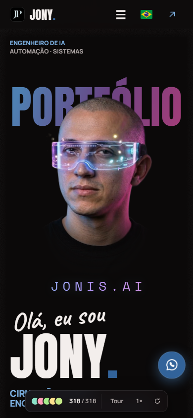
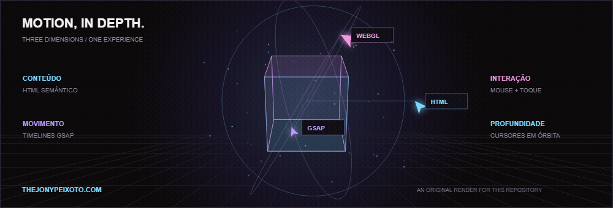

<p align="center">
  <a href="README.md"></a>
  <a href="README.pt-BR.md"></a>
  <a href="README.ru.md"></a>
  <a href="README.zh-CN.md"></a>
</p>
<p align="center"><a href="README.md">English</a> · <a href="README.pt-BR.md">Português</a> · <strong>Русский</strong> · <a href="README.zh-CN.md">简体中文</a></p>

<p align="center"><a href="https://www.thejonypeixoto.com/"></a></p>

<h1 align="center">THEJONYPEIXOTO.COM</h1>
<p align="center"><strong>Портфолио, которое собирается прямо перед вами.</strong><br />Jony Peixoto · «Цифровой хирург» · Инженерия ИИ и автоматизация</p>

Арабская версия доступна по адресу [/ar/](https://www.thejonypeixoto.com/ar/): флаг в меню, направление справа налево, локальный шрифт Noto Sans Arabic и анимация по словам, сохраняющая соединение букв. Юридические страницы остаются на португальском языке.


[Политика конфиденциальности](https://www.thejonypeixoto.com/privacidade/) и [условия использования](https://www.thejonypeixoto.com/termos/) доступны на португальском языке. Добавлены адаптивные изображения, отложенная загрузка галереи и контрастные подписи размеров; анимация сохранена. [Результаты аудита и оставшиеся задачи](docs/AUDITORIA.md) — на португальском. Для GA4 нужен идентификатор измерения; целевой мобильный LCP пока не достигнут.

<p align="center"><a href="https://www.thejonypeixoto.com/">Открыть сайт</a> · <a href="https://tally.so/r/Z9OlBy">Диагностика проекта</a> · <a href="docs/ARQUITETURA.md">Архитектура</a> · <a href="docs/MOTION.md">Как устроена анимация</a></p>
<p align="center">
<a href="https://github.com/jonypeixoto/thejonypeixoto.com/actions/workflows/build.yml"></a>


</p>

## Больше, чем страница

Рой курсоров собирает портфолио на глазах у посетителя: выделения с размерами, черновые контуры, печать по буквам, перетаскивание элементов и карточки, создаваемые из копий. Содержимое уже существует в HTML; анимация постепенно раскрывает интерфейс.

Здесь собраны проекты Jony Peixoto в области ИИ и автоматизации, профессиональный и игровой опыт, YouTube-канал, витрина ИИ, бренды и рассылка. Связаться можно через диагностику в Tally, WhatsApp и форму на странице.

[](https://www.thejonypeixoto.com/)

> 3D-сцены в README — это заранее отрендеренные GIF-анимации. Чтобы взаимодействовать с портретом и курсорами, откройте сайт. Демонстрация записана с локальной версии; версия на домене может отличаться.

## Что происходит на экране

| Возможность | Реализация |
|---|---|
| **Сборка в реальном времени** | Очередь задач GSAP, независимые агенты и декларативные HTML-атрибуты. |
| **Видеопортрет** | Полный ролик воспроизводится один раз после сборки портрета. |
| **Плавное появление очков** | Статичное фото и маска потока, реагирующая на мышь, касание и автоматическое движение в покое. |
| **Курсоры в глубине** | Стрелки движутся по кривым с перспективой и размытием. |
| **Tour** | Обход разделов с ожиданием сборки, скоростями 1×/2×/4× и повтором. |
| **Просмотр проектов** | Поиск, категории, мобильные горизонтальные списки и сравнение макета с итоговым экраном. |
| **Игровой опыт** | Веер карточек с перспективой, фокусом и упругим появлением в React-островке. |
| **Пять языков сайта** | Португальский, английский, испанский, русский и китайский; URL и сохранённые предпочтения. |
| **Связь** | Tally, локализованные сообщения WhatsApp и отправка через Web3Forms. |
| **Доступность анимации** | Уменьшение движения, пауза вне экрана и нативная прокрутка на мобильных устройствах. |

## Локальный запуск

Нужны **Node.js 22.12 или новее** и npm. Документированная среда разработки — Node.js 26.13.0 в Windows.

```bash
git clone https://github.com/jonypeixoto/thejonypeixoto.com.git
cd thejonypeixoto.com
npm ci
npm run dev
```

Откройте [localhost:5300](http://localhost:5300/). Для телефона в той же сети:

```bash
npm run dev -- --host 0.0.0.0
```

| Команда | Назначение |
|---|---|
| `npm run dev` | Сервер разработки Vite на порту 5300. |
| `npm run build` | Производственная сборка в `dist/`. |
| `npm run preview` | Просмотр сборки на порту 5300; сначала остановите сервер разработки. |

### Режимы просмотра

| Локальный URL | Назначение |
|---|---|
| `http://localhost:5300/` | Полная последовательность сборки. |
| `http://localhost:5300/?pronto` | Уже собранная страница; эффекты портрета остаются активными. |
| `http://localhost:5300/?lang=ru` | Русский язык сайта; также доступны `pt`, `en`, `es`, `zh`. |
| `http://localhost:5300/?reel=0.82` | Настройка белого для записи экрана и скрытие полосы прокрутки. |
| `http://localhost:5300/?pronto&lang=ru` | Просмотр готового макета на русском. |

`prefers-reduced-motion: reduce` открывает собранную страницу без агентов и со статичным портретом. Кнопки языка README переключают файлы документации; выбор языка сайта работает отдельно.

## Стек и решения

Основная страница использует **модульный HTML, CSS и JavaScript ES Modules**. Vite подставляет файлы разделов при разработке и сборке. React и React DOM применяются только в динамически загружаемом игровом карусельном компоненте. Результат — статичный сайт.

| Слой | Инструменты |
|---|---|
| Сборка | Vite 8.3.5 и локальный плагин `secoes` |
| Анимация | GSAP 3.15.0 |
| Портрет | WebM с альфа-каналом и запасной MP4 с цветом/маской рядом |
| Очки | WebGL и локальное поле потока на JavaScript |
| React-островок | React / React DOM 19.3.1 |
| Шрифты | Anton, Manrope, Caveat и Space Mono через Fontsource |
| Дизайн | CSS-токены, масштабы `--u` / `--su`, синий, фиолетовый и розовый на тёмном фоне |
| Внешние сервисы | Tally, Web3Forms, WhatsApp, YouTube и Substack |

## Структура кода

```text
.
├── index.html                # Метаданные, режимы открытия, маркеры разделов
├── vite.config.js            # Рекурсивная подстановка HTML-разделов
├── src/
│   ├── main.js               # Шрифты, стили, инициализация модулей
│   ├── estilo.js             # Показ страницы после загрузки CSS
│   ├── sections/             # HTML и CSS каждого раздела
│   ├── motion/               # Агенты, портрет, карусели, взаимодействие
│   ├── components/           # React-островок игровой карусели
│   ├── locales/              # Словари пяти языков сайта
│   └── styles/               # Токены, базовые и общие стили
├── public/
│   ├── img/                  # Портреты, проекты, бренды, новости, флаги
│   ├── video/                # Видеоматериалы портрета
│   ├── arquivos/             # PDF для скачивания
│   └── favicon.svg
├── docs/
│   ├── media/                # GIF и снимки экрана для README
│   └── tools/                # Исходники генерации 3D-анимаций
└── .github/workflows/        # Сборка при push и pull request
```

## Как работают очки



Поле **80 × 128 ячеек** переносит и постепенно рассеивает след. Шейдер совмещает его с областью очков и выделением голубого, синего, фиолетового света и бликов. На этом этапе видео стоит на паузе, поэтому лицо остаётся неподвижным.

Поведение вдохновлено [главным экраном Lando Norris](https://landonorris.com/), изученным по записям для компьютера/мобильного экрана и процессу [Reanimate](https://github.com/NiazMorshed2007/reanimate). Использованы материалы проекта и собственная локальная симуляция. **Покадровое соответствие оригиналу 1:1 не подтверждено.**

## Подробная документация

Технические руководства сейчас доступны **на португальском**. Четыре версии README дают обзор проекта на соответствующих языках.

| Документ | Содержание |
|---|---|
| [Архитектура](docs/ARQUITETURA.md) | Запуск, разделы, модули, CSS и React. |
| [Анимация и взаимодействие](docs/MOTION.md) | Контракт `data-*`, сборка, Tour, видео, альфа-канал, поток и доступность. |
| [Поддержка и публикация](docs/MANUTENCAO.md) | Редактирование контента, сервисы, сборка и размещение. |
| [История реализации](docs/IMPLEMENTACAO.md) | Исходная база, существующие изменения и работа этой сессии. |
| [Проверки](docs/VALIDACAO.md) | Выполненные проверки, свидетельства и ограничения. |
| [Источники и права](docs/CREDITOS.md) | База проекта, ссылки, зависимости, медиа и условия использования. |
| [SEO и локальный поиск](docs/SEO.md) | Заголовки, языковые URL, sitemap, структурированные данные и индексация. |
| [Анимации README](docs/tools/README.md) | Повторная генерация 3D-сцен и GIF. |

Языковые версии теперь имеют стабильные URL и готовый HTML: `/` (португальский), `/en/` (британский английский), `/es/`, `/ru/` и `/zh/`. Старые ссылки `?lang=` поддерживаются переходом в браузере. Язык корневой страницы больше не зависит от настроек браузера. После сборки выполните `npm run check:seo`.

## Размещение

```bash
npm ci
npm run build
```

Разместите **содержимое `dist/`** на статическом хостинге. Node.js-сервер в продакшене не требуется. Пути ресурсов начинаются с `/`, поэтому приложение рассчитано на корень домена.

Существующий проект Vercel **`thejonypeixoto`** подключён к **`jonypeixoto/thejonypeixoto.com`**. Push в `main` запускает развёртывание Vercel; рабочий домен — [www.thejonypeixoto.com](https://www.thejonypeixoto.com/). GitHub Actions отдельно проверяет сборку и статические SEO-метаданные.

Опубликованы [sitemap](https://www.thejonypeixoto.com/sitemap.xml), [robots](https://www.thejonypeixoto.com/robots.txt) и [изображение для WhatsApp](https://www.thejonypeixoto.com/img/og-jony-peixoto-whatsapp.jpg): JPEG 1200 × 630 с полностью видимым лицом. Глобальный `<Analytics />` использует `@vercel/analytics/react`, поскольку сайт работает на Vite, а не Next.js. Скрипт проверен на рабочем домене. Подробнее: [статус публикации](docs/PUBLICACAO.md).

Пять обновлённых URL отправлены через IndexNow. Google не использует IndexNow; проверка Search Console и запрос индексации выполняются отдельно. Мгновенная индексация и позиции в поиске не гарантируются.

## Качество и известные ограничения

- Локальные проверки Chromium: 1456 × 840 и 390 × 844, включая эмуляцию касаний.
- Во время реализации портрета проверялись Tour, повтор, пауза вне экрана, уменьшение движения и горизонтальное переполнение.
- Локальная сборка прошла. Существующее предупреждение `"use client"` в JSX-карусели не препятствует сборке.
- Safari и реальные устройства требуют отдельной проверки. Оценка Lighthouse и покрытие автоматическими тестами не заявляются.
- Сохранились руководства базы Kairo и демонстрационные изображения проектов. Они описаны в [источниках](docs/CREDITOS.md); кейсы, показатели и тексты должен подтвердить владелец сайта.

<details>
<summary>Снимки экрана: компьютер и мобильное устройство</summary>
<p align="center"></p>
</details>

<p align="center"></p>
<p align="center"><strong>От повторяющихся задач к работающим решениям.</strong><br /><a href="https://tally.so/r/Z9OlBy">Расскажите о вашем следующем проекте</a> · <a href="https://github.com/jonypeixoto">@jonypeixoto</a> · <a href="https://www.youtube.com/@thejonypeixoto">YouTube</a> · <a href="https://jonypeixoto.substack.com/">Рассылка</a></p>
