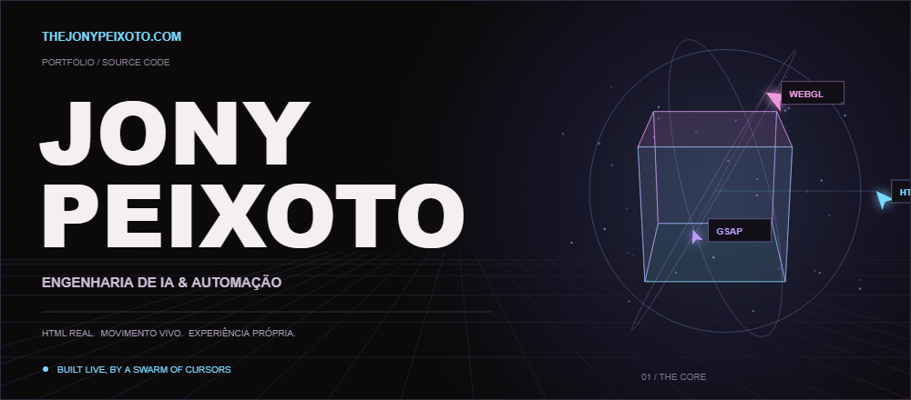
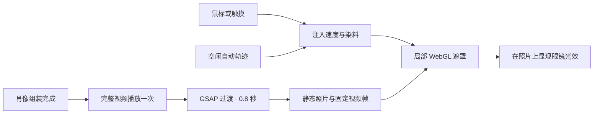
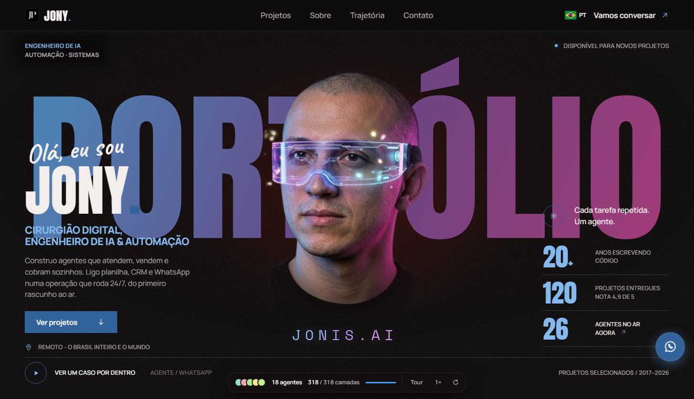
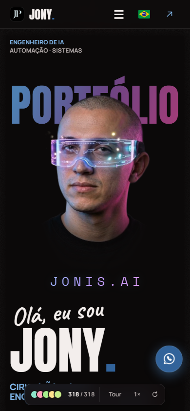
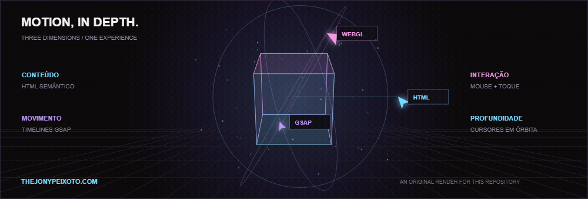

<p align="center">
  <a href="README.md"></a>
  <a href="README.pt-BR.md"></a>
  <a href="README.ru.md"></a>
  <a href="README.zh-CN.md"></a>
</p>
<p align="center"><a href="README.md">English</a> · <a href="README.pt-BR.md">Português</a> · <a href="README.ru.md">Русский</a> · <strong>简体中文</strong></p>

<p align="center"><a href="https://www.thejonypeixoto.com/"></a></p>

<h1 align="center">THEJONYPEIXOTO.COM</h1>
<p align="center"><strong>一个在你眼前逐步构建的作品集。</strong><br />Jony Peixoto · 数字外科医生 · 人工智能与自动化工程</p>
<p align="center"><a href="https://www.thejonypeixoto.com/">访问网站</a> · <a href="https://tally.so/r/Z9OlBy">开始项目诊断</a> · <a href="docs/ARQUITETURA.md">架构</a> · <a href="docs/MOTION.md">动画实现</a></p>
<p align="center">
<a href="https://github.com/jonypeixoto/thejonypeixoto.com/actions/workflows/build.yml"></a>


</p>

## 不止是一个页面

一群彩色光标会在访客眼前组装作品集：显示尺寸的选框、线框草图、逐字输入的文字、被拖到正确位置的元素，以及通过复制生成的卡片。内容从一开始就存在于 HTML 中，动画负责逐步呈现界面。

本项目展示 Jony Peixoto 的个人形象、人工智能与自动化项目、职业及游戏开发经历、YouTube 频道、AI 展示、品牌和通讯内容。访客可以通过 Tally 项目诊断、WhatsApp 或页面表单联系他。

[](https://www.thejonypeixoto.com/)

> README 中的 3D 场景是预先渲染的 GIF 动画。请打开网站，与肖像、光标和组件互动。演示录制自本地版本，可能与域名当前发布的版本不同。

## 屏幕上的体验

| 功能 | 实现方式 |
|---|---|
| **实时组装** | GSAP 任务队列、独立光标代理和声明式 HTML 属性。 |
| **视频肖像** | 肖像组装完成后，完整视频播放一次。 |
| **流体眼镜效果** | 视频结束后显示静态照片；鼠标、触摸或自动轨迹通过流体遮罩逐步显现眼镜。 |
| **纵深光标** | 箭头沿曲线运动，并带有透视和模糊效果。 |
| **Tour 导览** | 依次浏览各个区域并等待组装，提供 1×、2×、4× 与重播控制。 |
| **项目浏览** | 搜索、分类筛选、移动端横向列表，以及线框稿与最终界面对比。 |
| **游戏开发经历** | 带有透视、聚焦和弹性入场效果的扇形卡片，作为 React 岛屿加载。 |
| **五种网站语言** | 葡萄牙语、英语、西班牙语、俄语和中文，支持 URL 参数与本地偏好。 |
| **联系服务** | Tally 诊断、本地化 WhatsApp 消息和 Web3Forms 表单提交。 |
| **无障碍动效** | 尊重减少动态效果偏好、离屏暂停，并保留移动端原生滚动。 |

## 本地运行

需要 **Node.js 22.12 或更高版本**以及 npm。记录中的开发环境为 Windows 上的 Node.js 26.13.0。

```bash
git clone https://github.com/jonypeixoto/thejonypeixoto.com.git
cd thejonypeixoto.com
npm ci
npm run dev
```

打开 [localhost:5300](http://localhost:5300/)。如需在同一网络中的手机上访问：

```bash
npm run dev -- --host 0.0.0.0
```

| 命令 | 用途 |
|---|---|
| `npm run dev` | 在 5300 端口启动 Vite 开发服务器。 |
| `npm run build` | 将生产构建输出到 `dist/`。 |
| `npm run preview` | 在 5300 端口预览构建；请先停止开发服务器。 |

### 预览模式

| 本地 URL | 用途 |
|---|---|
| `http://localhost:5300/` | 完整的实时组装体验。 |
| `http://localhost:5300/?pronto` | 直接显示组装完成的页面，肖像特效仍然运行。 |
| `http://localhost:5300/?lang=zh` | 以中文打开网站；还支持 `pt`、`en`、`es`、`ru`。 |
| `http://localhost:5300/?reel=0.82` | 为屏幕录制调整白色亮度并隐藏滚动条。 |
| `http://localhost:5300/?pronto&lang=zh` | 以中文检查组装完成后的布局。 |

启用 `prefers-reduced-motion: reduce` 时，页面直接显示完成状态，禁用光标代理并保留静态肖像。README 的语言按钮切换文档文件，网站本身的语言选择独立运行。

## 技术栈与设计决策

页面主体使用**模块化 HTML、CSS 和 JavaScript ES Modules**。Vite 在开发和构建阶段展开各个区域文件，最终生成静态网站。React 与 React DOM 仅用于按需加载的游戏卡片轮播岛屿。

| 层级 | 技术 |
|---|---|
| 构建 | Vite 8.3.5 与本地 `secoes` 插件 |
| 动画 | GSAP 3.15.0 |
| 肖像 | 带透明通道的 WebM，以及颜色和遮罩并排编码的 MP4 回退方案 |
| 眼镜合成 | WebGL 与 JavaScript 本地流体场 |
| 界面岛屿 | React / React DOM 19.3.1 |
| 字体 | 通过 Fontsource 加载 Anton、Manrope、Caveat 和 Space Mono |
| 视觉系统 | CSS 设计令牌、`--u` / `--su` 缩放，以及深色背景上的蓝、紫、粉色 |
| 外部服务 | Tally、Web3Forms、WhatsApp、YouTube 和 Substack |

## 代码结构

```text
.
├── index.html                # 元数据、启动模式与区域标记
├── vite.config.js            # 递归展开模块化 HTML
├── src/
│   ├── main.js               # 字体、样式与模块初始化
│   ├── estilo.js             # CSS 就绪后显示页面
│   ├── sections/             # 各区域的 HTML 与 CSS
│   ├── motion/               # 光标群、肖像、轮播与交互
│   ├── components/           # 游戏轮播 React 岛屿
│   ├── locales/              # 网站五种语言的词典
│   └── styles/               # 设计令牌、基础与共享样式
├── public/
│   ├── img/                  # 肖像、项目、品牌、新闻与旗帜
│   ├── video/                # 项目使用的肖像视频
│   ├── arquivos/             # 可下载的 PDF
│   └── favicon.svg
├── docs/
│   ├── media/                # README 的 GIF 与截图
│   └── tools/                # 可复现的 3D 动画生成源代码
└── .github/workflows/        # push 与 pull request 触发构建
```

## 流体眼镜的实现



**80 × 128 网格的流体场**负责输运和逐渐消散运动轨迹。着色器结合眼镜区域，以及视频固定帧中的青色、蓝色、紫色光线和高光，生成显现效果。此阶段视频保持暂停，脸部不会随轨迹移动。

交互行为参考了 [Lando Norris 网站的首屏](https://landonorris.com/)，分析材料包括桌面与移动端录屏，并使用 [Reanimate](https://github.com/NiazMorshed2007/reanimate) 工作流辅助研究。本项目使用自身媒体素材和独立的本地模拟。**尚未验证与原作逐帧 1:1 一致。**

## 完整技术文档

详细工程文档目前使用**葡萄牙语**编写。四个 README 版本分别提供对应语言的项目概览。

| 文档 | 内容 |
|---|---|
| [架构](docs/ARQUITETURA.md) | 启动顺序、页面区域、模块职责、CSS 与 React。 |
| [动画与交互](docs/MOTION.md) | `data-*` 约定、组装、Tour、视频、透明通道、流体场与无障碍。 |
| [维护与部署](docs/MANUTENCAO.md) | 修改内容、配置服务、构建与发布。 |
| [实现记录](docs/IMPLEMENTACAO.md) | 原始基础、既有定制内容及本次会话中的变更。 |
| [验证](docs/VALIDACAO.md) | 已执行的检查、证据与已知限制。 |
| [来源与素材使用](docs/CREDITOS.md) | 项目基础、参考、依赖、媒体及使用权。 |
| [SEO 与本地搜索](docs/SEO.md) | 多语言标题、静态语言 URL、站点地图、结构化数据与索引步骤。 |
| [README 动画](docs/tools/README.md) | 重新生成 3D 场景和 GIF。 |

网站语言现在使用稳定且预渲染的 URL：`/`（葡萄牙语）、`/en/`（英式英语）、`/es/`、`/ru/` 和 `/zh/`。旧的 `?lang=` 链接仍通过浏览器导航兼容。根页面不再根据浏览器设置自动切换语言。构建后请运行 `npm run check:seo`。

## 部署

```bash
npm ci
npm run build
```

将 **`dist/` 的内容**发布到静态托管服务。生产环境不需要 Node.js 服务器。资源使用以 `/` 开头的绝对路径，因此应用应部署在域名根目录。

仓库工作流仅验证构建，**不会修改 DNS，也不会自动将网站部署到域名**。配置托管之前，请阅读[部署文档](docs/MANUTENCAO.md)。

## 质量与已知限制

- 在 Chromium 中进行过 1456 × 840 与 390 × 844 的本地检查，包括触摸模拟。
- 肖像实现过程中检查过 Tour、重播、离屏暂停、减少动态效果和水平溢出。
- 本地生产构建已通过；JSX 轮播中已有的 `"use client"` 警告不影响构建输出。
- Safari 与真实移动设备仍需单独验证。本项目不声明 Lighthouse 分数或自动化测试覆盖率。
- 仓库保留了 Kairo 基础模板的指南和示例项目媒体，详见[来源说明](docs/CREDITOS.md)。项目案例、数据和文案仍需网站负责人确认。

<details>
<summary>查看桌面与移动端截图</summary>
<p align="center"></p>
</details>

<p align="center"></p>
<p align="center"><strong>从重复流程，到真正有效的体验。</strong><br /><a href="https://tally.so/r/Z9OlBy">聊聊你的下一个项目</a> · <a href="https://github.com/jonypeixoto">@jonypeixoto</a> · <a href="https://www.youtube.com/@thejonypeixoto">YouTube</a> · <a href="https://jonypeixoto.substack.com/">通讯</a></p>
