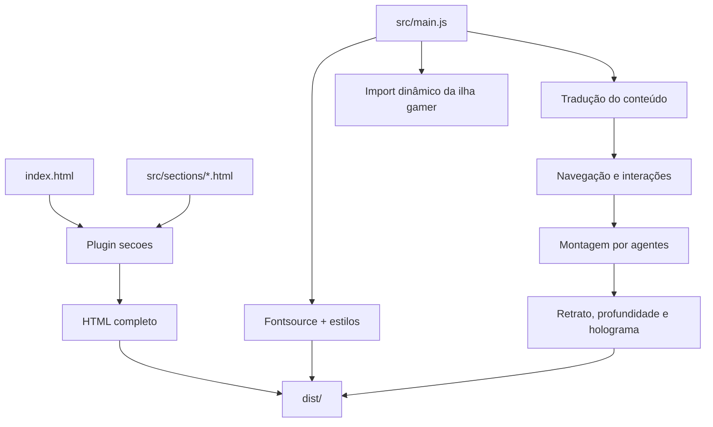

# Arquitetura

[Voltar ao README](../README.md)

## Modelo da aplicação

O site é uma página estática produzida por Vite, com seções HTML independentes. A maior parte da interface usa JavaScript nativo; a galeria gamer recebe uma ilha React, importada sob demanda. Não há backend de aplicação neste repositório.

`index.html` contém metadados, scripts pequenos de abertura e marcas `<!-- @secao nome -->`. O plugin `secoes`, em `vite.config.js`, substitui as marcas pelos arquivos de `src/sections/`. A expansão é recursiva e acontece antes das transformações do Vite, tanto no desenvolvimento quanto no build.

## Ordem de inicialização

1. Os scripts de `index.html` definem `monta` ou `pronto`, leem `?reel` e detectam toque/movimento reduzido. Um fallback libera o conteúdo caso o enxame não inicialize em cinco segundos.
2. O CSS é importado por `main.js`. `estilo.js` coordena a liberação visual da página no desenvolvimento.
3. `idiomas()` resolve URL, preferência salva e idioma do navegador antes de iniciar a digitação e o restante do motion.
4. `nav()` e `interface_()` ligam navegação, filtros, comparador, sanfona e formulário.
5. `gamer()` preserva o HTML como fonte de dados e carrega a ilha React quando o movimento é permitido. Se a inicialização falhar, a galeria HTML continua disponível.
6. `enxame(barra())` inicia a construção; carrosséis, retrato, profundidade, convite de WhatsApp e holograma completam a experiência.

## Seções

| Arquivo em `src/sections/` | Responsabilidade |
|---|---|
| `icones.html` | Sprite SVG: símbolos de ferramentas e ícones de interface. |
| `nav.html` / `.css` | Marca, âncoras, idiomas e contato principal. |
| `hero.html` / `.css` | Identidade, foto/vídeo, título, números e chamadas. |
| `projetos.html` / `.css` | Cards, categorias, busca, ferramentas e comparador. |
| `sobre.html` / `.css` | Biografia, formação, serviços, processo e PDF. |
| `trajetoria.html` / `.css` | Linha profissional e sanfona de experiências. |
| `youtube.html` / `.css` | Destaque para o canal de Jony. |
| `gamer.html` / `.css` | Histórico de jogos e fonte de dados para o leque. |
| `ias.html` / `.css` | Vitrine e navegação das personagens de IA. |
| `marcas.html` / `.css` | Faixa horizontal de marcas. |
| `noticias.html` / `.css` | Cards editoriais, links para Substack e mídias. |
| `contato.html` / `.css` | Tally, canais, formulário, replay e rodapé. |
| `barra.html` / `.css` | Estado da montagem, Tour, velocidade e replay. |

## Módulos de comportamento

| Arquivo em `src/motion/` | O que controla |
|---|---|
| `enxame.js` | Fila, tarefas, abertura, duplicação, ajuste, testes, Tour e fila final. |
| `agentes.js` | SVG dos cursores, cores, movimento em curva e desenho por ticker. |
| `caixas.js` | Seleção de editor, etiquetas de medidas e rascunhos. |
| `digita.js` | Texto letra a letra em elementos `<x-l>`. |
| `barra.js` | Interface dos controles e indicadores da montagem. |
| `interface.js` | Filtro, busca, faixa de ferramentas, comparador, sanfona e formulário. |
| `nav.js` | Seção ativa e comportamento de hover durante a rolagem. |
| `idiomas.js` | Dicionários, metadados, seletor e mensagens de WhatsApp por idioma. |
| `gamer.js` | Dados dos cards, alternativa HTML e import dinâmico do leque React. |
| `ias.js` | Loop, setas, teclado e pausas da vitrine de IAs. |
| `marcas.js` | Faixa de marcas, clones e pausa durante interação. |
| `noticias.js` | Movimento horizontal automático com pausa por interação. |
| `video-hero.js` | Estados de entrada, vídeo completo, transição, foto e efeitos. |
| `video-alpha.js` | Composição WebGL, alfa, recorte e máscara dos óculos. |
| `rosto-fluido.js` | Simulação local e resposta a ponteiro/toque. |
| `profundidade.js` | Cursores atravessando o espaço em perspectiva. |
| `holograma.js` | Movimento e iluminação do nome JONIS.AI. |
| `whatsapp.js` | Convite flutuante após rolar, intervalos e fechamento. |
| `pais-formulario.js` | Estimativa de país e fallback que não bloqueia envio. |
| `compatibilidade.js` | Observação de mudanças de media queries. |

## CSS e identidade

`src/styles/tokens.css` centraliza cores, fontes, tamanhos e escalas. Os nomes históricos `--vermelho` e `--vermelho-texto` foram mantidos por compatibilidade com a base; seus valores atuais representam o acento azul. O título e o holograma combinam azul, violeta e rosa.

- `--u`: escala de cena do hero, baseada em um quadro de 1440 × 900.
- `--su`: escala das demais seções, com contêiner de 1280 e adaptação mobile.
- Corte principal de layout: 760 px.
- `base.css`: elementos globais, rolagem, foco e estrutura.
- `secao.css`: títulos, rótulos, abas, tags e peças compartilhadas.
- `enxame.css`: estados de montagem, placeholders e ferramenta dos agentes.
- `idiomas.css`: seletor e ajustes de texto.

Cada nova peça que participa da montagem precisa manter o contrato de atributos descrito em [MOTION.md](MOTION.md). Inserir apenas CSS de entrada não a coloca automaticamente na fila do enxame.

## Ilha React

`src/components/gamer-fan.jsx` monta `src/components/ui/card-fan-carousel.jsx`. O HTML da seção continua sendo a fonte dos títulos, imagens e links; não existe uma segunda lista de conteúdo mantida manualmente no JSX. A galeria alternativa é usada quando o movimento reduzido está ativo.

A diretiva `"use client"` é herdada do componente. Este site não usa Next.js; o Vite emite um aviso sobre essa diretiva, mas conclui o build.

## Distribuição

`public/` é copiada para a raiz do build. `src/` vira bundles com nomes versionados. Não publique `node_modules/`, caches ou capturas de trabalho. Não há roteamento SPA próprio, armazenamento de leads no servidor nem uma conexão de hospedagem configurada pelo workflow deste repositório.
