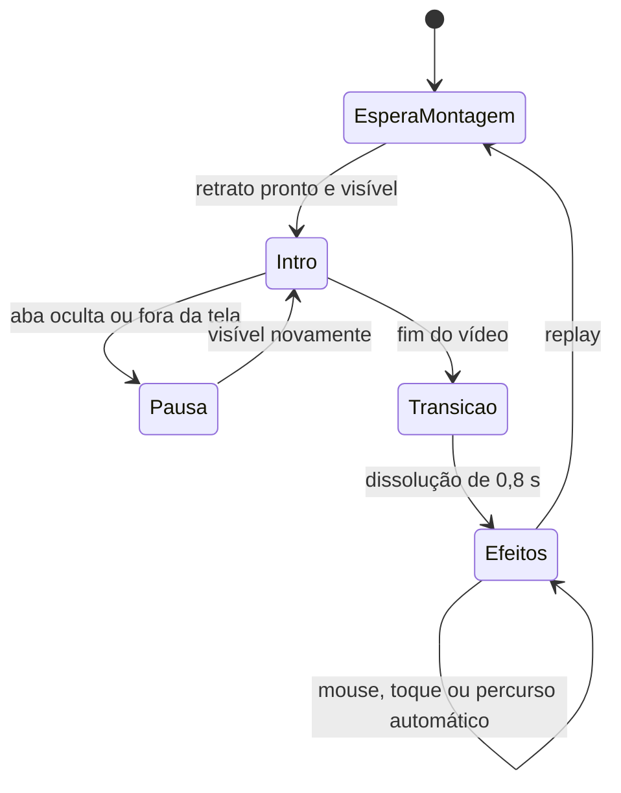

# Motion e interação

[Voltar ao README](../README.md)

## O princípio da montagem

O HTML é conteúdo; o enxame é uma camada de apresentação. Um agente seleciona uma área, mostra medidas, desenha um rascunho e revela a peça. Texto, título e mídia têm tratamentos diferentes. GSAP coordena as tarefas; a montagem não usa pin para prender a página.

| Atributo | Contrato |
|---|---|
| `data-montagem` | Agrupa camadas; a montagem começa quando o topo cruza aproximadamente 62% da altura da tela. |
| `data-camada="quadro"` | Fundo de uma área inteira. |
| `data-camada="titulo"` | Título revelado letra por letra. |
| `data-camada="texto"` | Digitação de conteúdo em `<x-l>`. |
| `data-camada="bloco"` | Caixa, fundo ou borda; respeita camadas internas. |
| `data-camada="foto"` | Entrada de mídia com tratamento visual próprio. |
| `data-parte` | Divide a montagem do hero no celular. |
| `data-reforco="N"` | Adiciona agentes na entrada de uma seção. |
| `data-duplica` | Monta o primeiro item e produz os seguintes a partir de cópias. |
| `data-ajusta="dx,dy"` | Nasce deslocado; um agente arrasta até a posição final. |
| `data-teste="1,0"` | Teste de botões após montar; `arraste` aciona o comparador. |
| `data-tocado` | Cancela o teste automático depois da interação humana. |
| `data-fecho` / `data-alvo` | Define a área final e o alvo da fila dos agentes. |

### Cuidados ao editar

- Uma peça sem `data-camada` aparece antes da montagem.
- Elementos com ajuste precisam aceitar transformação: use bloco ou `inline-block`.
- Em links/botões `flex` com `gap`, envolva o texto em um ``; letras digitadas não devem virar itens flex separados.
- Repetições devem preservar `data-duplica` no contêiner correto.
- No celular, mantenha a rolagem horizontal somente dentro dos trilhos previstos; `main` contém os deslocamentos de montagem.

## Tour, velocidades e replay

`barra.js` apresenta os controles e informa eventos ao enxame. A velocidade usa `gsap.globalTimeline.timeScale()`. Tour navega pelas montagens, espera o trabalho e termina no fecho. Interação humana por toque interrompe o percurso. Replay volta ao início e recoloca as camadas em montagem.

Quando a pessoa rola rápido, tarefas de conteúdo que passou da tela precisam encerrar para não trazer agentes de volta às áreas já percorridas.

## Retrato: vídeo → foto → óculos

Com movimento reduzido, a pessoa vê a foto estática. Sem suporte gráfico ou após falha, a foto permanece como alternativa.

### Entrada

`video-hero.js` cria um `<video>` mudo, com `playsInline`, sem controles e com `preload="none"`. A mídia só começa depois da montagem, quando o retrato está visível. `loop` é falso: o vídeo completo toca uma vez.

- Desktop: `public/video/jony-sem-fundo.webm`.
- Mobile e alternativa para alfa: `public/video/jony-alpha-mobile.mp4`.
- Fonte estática: `public/img/jony-perfil.webp`.

O vídeo e a foto têm enquadramentos diferentes; o alinhamento é feito pelo CSS de `.hero__video`. Ao trocar as mídias, esses valores precisam ser recalibrados.

### Composição de transparência

O shader em `video-alpha.js` recebe o frame de vídeo. No MP4, a metade esquerda transporta a cor e a metade direita transporta a máscara em tons de cinza. O WebM usa seu alfa nativo, com uma checagem no navegador e alternativa para o MP4 quando necessário.

O canvas de composição tem 540 × 960. A saída é alinhada à foto e recebe os fades inferiores definidos no CSS. Os shaders e o campo fluido são locais; o site não usa o modelo 3D, as texturas ou o retrato da referência de Lando Norris.

### Etapa estática

Depois de `ended`, uma transição GSAP de 0,8 s revela a foto e troca o shader para o recorte dos óculos. O vídeo é levado ao quadro inicial e fica pausado. O ticker continua desenhando a máscara, sem reproduzir movimentos da cabeça.

A máscara combina três condições: a região horizontal dos olhos, as luzes ciano/azuis/violetas e highlights do quadro fixo, e o rastro fluido da interação. Essa seleção por cor evita reapresentar pele e boca do vídeo em cima da foto.

### Campo fluido em tempo real

`rosto-fluido.js` mantém velocidades X/Y, pressão, divergência e tinta em uma grade de **80 × 128**. A cada passo:

1. Converte mouse ou toque para coordenadas locais do vídeo.
2. Suaviza o ponto de entrada e interpola os segmentos de movimento.
3. Injeta força e tinta somente na região percorrida.
4. Transporta os campos pela velocidade, aplica quatro iterações de pressão e dissipa o rastro.
5. Envia a densidade para uma textura WebGL; a densidade vira a revelação dos óculos.

O cálculo usa passos de 1/60 s, com limite por atualização. A dissipação da velocidade é 0,96 por passo e a da tinta é 0,985. O raio de injeção é 14 células. Esses valores são os parâmetros atuais da adaptação; não representam uma medição de equivalência com a referência.

**Não existe um fade global do par inteiro ao entrar com o mouse.** Um toque injeta uma região; arrastar desenha um rastro contínuo. Os eventos são passivos, sem captura de ponteiro ou `preventDefault`, preservando a rolagem nativa.

### Repouso

Após a espera inicial, o efeito faz um percurso autônomo na faixa dos olhos. O movimento de ida dura 2,5 s, a volta começa em 4 s e dura 2,5 s; há uma pausa de repetição de 3 s. O eixo horizontal usa `power1.inOut`, e o vertical é linear. A interação humana interrompe o percurso; ele retorna após o intervalo de repouso.

### Setas e holograma

O efeito dos óculos não substitui `profundidade.js`, `agentes.js` ou `enxame.js`. As setas em perspectiva continuam separadas da máscara do retrato. `holograma.js` coordena a iluminação de JONIS.AI, respeitando visibilidade e movimento reduzido.

## Referência e fidelidade

O estudo usou o [site de Lando Norris](https://landonorris.com/), gravações de desktop e mobile fornecidas pelo responsável e a skill [Reanimate](https://github.com/NiazMorshed2007/reanimate). Houve extração de frames, inspeção visual e leitura dos parâmetros públicos de interação.

A referência usa uma composição 3D com capacete e simulação GPU. Este projeto adapta o comportamento a óculos luminosos de um vídeo próprio, com simulação CPU local e composição WebGL. **Não há comprovação de correspondência quadro a quadro nem de erro visual abaixo de um limiar numérico.** As capturas originais, ferramentas baixadas e rascunhos de comparação ficam fora do repositório público.
